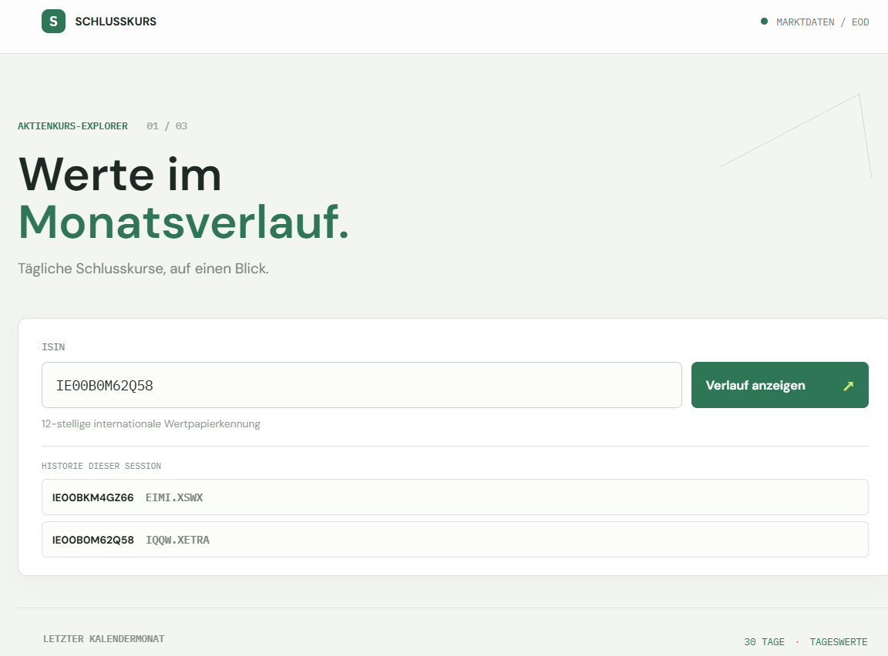
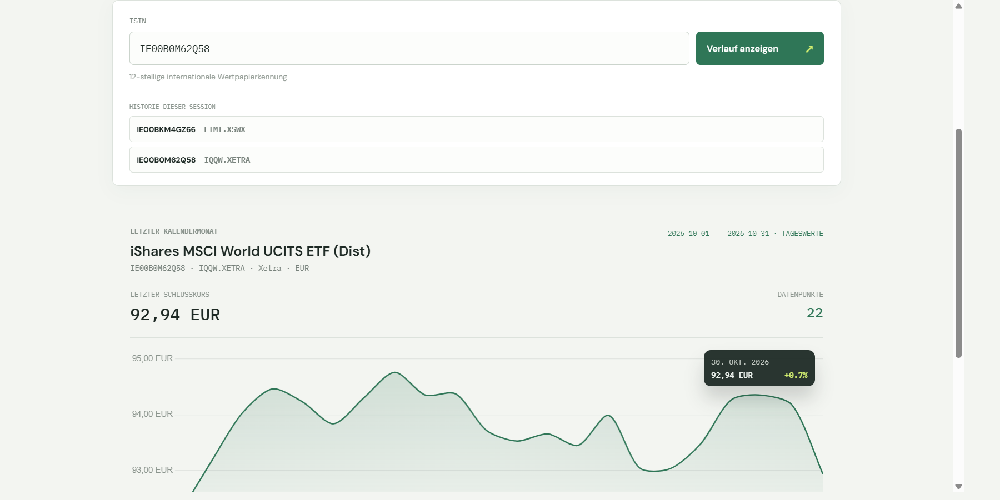

# Aktienkurs-Explorer

A personal learning project for experimenting with Rust APIs, browser clients, and an end-to-end agentic development workflow with GitHub Copilot.

## Screenshots

The main view shows the ISIN input and session history. The second view shows the loaded monthly price chart.

<table>
	<tr>
		<td align="center"></td>
		<td align="center"></td>
	</tr>
	<tr>
		<td align="center"><strong>Main view and session history</strong></td>
		<td align="center"><strong>Loaded monthly price chart</strong></td>
	</tr>
</table>

## Why this project exists

I use this repository as a technology playground: to try Rust API development, connect multiple endpoints over time, and explore how several web pages or clients can use the same backend. The broader goal is to grow the project into a small multi-endpoint, multi-page application while keeping each step testable and understandable.

The current proof of concept is intentionally smaller: one browser page calls `GET /api/history`, which returns daily closing prices for the previous completed calendar month. The UI is in German. The screenshots show the working flow with two ISINs in the session history and a rendered price chart. The current Rust test suite has 21 offline tests.

My main learning goal is to experience an agentic workflow from beginning to end without manually writing the implementation myself. I want to describe the outcome, shape requirements into tasks, let GitHub Copilot plan and implement the changes, and then learn by reviewing the tests, verification results, and documentation. The repository's `PAD.md`, `PRD.md`, `TASK.md`, `PIV.md`, and `STATUS.md` files make that workflow visible and repeatable. I guide decisions and review the result; Copilot does the hands-on coding.

## Current use case

- Enter an ISIN and load the previous completed calendar month's daily closing prices.
- Resolve instruments through a verified mapping or OpenFIGI followed by Marketstack's ticker catalog.
- Browse successful ISINs from the current browser session. Only the ISIN and verified symbol are retained; prices are fetched again when an entry is selected.
- Keep provider credentials on the Rust server, never in browser code.

This is a learning project, not a trading product or investment advice. Price availability depends on the instrument, exchange, and provider plan.

## Technology experiments

- **Backend:** Rust 2024, Axum, Tokio, and a JSON HTTP API.
- **Market data:** Marketstack EOD data, with OpenFIGI and Marketstack ticker-catalog lookup for instrument resolution.
- **Browser:** static HTML, CSS, and JavaScript with Chart.js.
- **Verification:** local Rust tests use fake providers and run without a network connection or API key.

The architecture keeps the browser independent of provider credentials and allows additional API endpoints and web clients to be explored incrementally.

## Run locally

Requirements: a stable Rust toolchain with Rust 2024 edition support and a Marketstack API key for live price requests.

Create a local `.env` file in the project root:

```dotenv
MARKETSTACK_API_KEY=replace_with_your_key
APP_DEBUG=true
```

The `.env` file is git-ignored. Keep your real API key out of source files, screenshots, and commits.

Start the server:

```sh
cargo run
```

Open <http://127.0.0.1:3000>.

Run the offline checks:

```sh
cargo test
cargo fmt --check
```

## Project map

- [`docs/ARCHITECTURE.md`](docs/ARCHITECTURE.md): architecture and code walkthrough.
- [`PRD.md`](PRD.md): product requirements and current scope.
- [`PAD.md`](PAD.md): stable architecture decisions.
- [`TASK.md`](TASK.md) and [`PIV.md`](PIV.md): latest completed task and plan-implement-verify workflow.
- [`STATUS.md`](STATUS.md): verified project status and known limitations.
- [`LEARNING_PLAN.md`](LEARNING_PLAN.md): agent-led learning goals and implementation stages.
- [`.github/prompts/wrap-up.prompt.md`](.github/prompts/wrap-up.prompt.md): reusable documentation, verification, and commit wrap-up.
