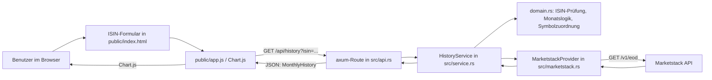

# Architektur des Aktienkurs-Explorers

## 1. Systemkontext

Der Aktienkurs-Explorer ist ein kleiner Rust-Backend-Server mit statischem Browser-Frontend. Der Browser akzeptiert eine ISIN, ruft den eigenen HTTP-Endpunkt auf und rendert anschließend die vom Server gelieferten täglichen Schlusskurse als Liniendiagramm.

Die Kernkomponenten sind:

- `src/main.rs`: Startet den Axum-Server und lädt den API-Schlüssel.
- `src/api.rs`: Definiert die HTTP-Routen und serialisiert Fehlerzustände als JSON.
- `src/service.rs`: Orchestriert Validierung, Symbolzuordnung, Monatsgrenze und Provider-Aufruf.
- `src/domain.rs`: Enthält interne Typen, ISIN-Prüfung und die expliziten Symbolzuordnungen.
- `src/marketstack.rs`: Hält den Marketstack-Adapter und die Anbieter-Fehlerbehandlung.
- `public/`: Statisches HTML, CSS und JavaScript für die Browser-Oberfläche.

## 2. Request-Ablauf für GET /api/history?isin=...

Der komplette Ablauf beginnt im Browser über das Formular in `public/index.html` und dem Script in `public/app.js`.

1. Der Benutzer gibt eine ISIN ein und sendet das Formular.
2. `public/app.js` ruft `fetch('/api/history?isin=...')` auf.
3. Die Axum-Route in `src/api.rs` verarbeitet die Anfrage mit `Query<HistoryQuery>` und übergibt die ISIN an `HistoryService::previous_month`.
4. `HistoryService` normalisiert die Eingabe mit `normalize_isin` und prüft sie mit `is_valid_isin`.
5. Wenn die ISIN syntaktisch ungültig ist, endet der Ablauf mit `HistoryError::InvalidIsin`.
6. Danach wird mit `resolve_known_instrument` eine explizite Zuordnung gesucht. Ein unbekannter Wert wird als `UnsupportedIsin` abgelehnt.
7. Der letzte abgeschlossene Kalendermonat wird mit `previous_calendar_month(Utc::now().date_naive())` bestimmt.
8. Der Service ruft `provider.daily_closes(symbol, from, to)` auf. Der Provider ist `MarketstackProvider`.
9. `MarketstackProvider` baut den echten Marketstack-Request auf:
   - Route: `https://api.marketstack.com/v1/eod`
   - Parameter: `access_key`, `symbols`, `date_from`, `date_to`
10. Die Antwort wird in interne Datentypen umgewandelt.
11. Nur Werte innerhalb des Monatsbereichs werden beibehalten, nach Datum sortiert und als `MonthlyHistory` an den HTTP-Handler zurückgegeben.
12. Der Browser rendert anschließend `payload.points` als Chart und zeigt Name, ISIN, Symbol, Börse, Zeitraum und letzten Schlusskurs an.

## 3. Verantwortung der Module und des statischen Browser-Clients

### `src/domain.rs`

Dieses Modul bildet die fachliche Grundlage und ist weitgehend unabhängig von der Anbieter-API:

- `Instrument`: Interner Datensatz für ISIN, Symbol, Name, Börse und Währung.
- `DailyClose`: Ein Tageswert mit Datum und Schlusskurs.
- `MonthlyHistory`: Der öffentliche Ergebnisdatensatz mit Zeitraum und Verlauf.
- `normalize_isin`: Entfernt Leerzeichen und setzt Buchstaben auf Großschreibung.
- `is_valid_isin`: Validiert Format und Prüfziffer gemäß ISIN-Regel.
- `resolve_known_instrument`: Enthält die derzeit explizit geprüften Zuordnungen.
- `previous_calendar_month`: Berechnet den vorherigen kompletten Kalendermonat.

### `src/service.rs`

Dieses Modul steuert den Anwendungsablauf:

- `HistoryService` kapselt den `MarketDataProvider`.
- `HistoryError` definiert die fachlichen Fehlerfälle.
- `previous_month` führt die Reihenfolge aus: Normalisierung → Validierung → Zuordnung → Monatsermittlung → Provider-Aufruf → Sortierung → Ergebnisbildung.

### `src/marketstack.rs`

Der Adapter ist die einzige Stelle, an der Marketstack direkt angesprochen wird:

- `MarketstackProvider` kapselt `reqwest::Client` und API-Key.
- `daily_closes` setzt `access_key`, `symbols`, `date_from` und `date_to`.
- `ProviderError` übersetzt Provider-Situationen in ein internes Fehlermodell.
- Die Verarbeitung erwartet eine `data`-Liste mit `date` und `close`.
- Fehlende oder nicht-finite Werte führen zu einem gültigen Provider-Fehler statt zu einer stillen Auslassung.

### `src/api.rs`

Der HTTP-Layer übersetzt fachliche Fehler in HTTP-Responses:

- `GET /api/history` ist die einzige Route für die Monatsabfrage.
- Es werden nur JSON-Responses mit `error.code` und `error.message` geliefert.
- Das Mapping ist bewusst auf klare Zustände beschränkt:
  - `invalid_isin` → 400 Bad Request
  - `unsupported_isin` → 422 Unprocessable Entity
  - `no_data` → 404 Not Found
  - `provider_plan_restricted` / `provider_rate_limited` → 502 bzw. 429
  - generische Providerfehler → 502 Bad Gateway

### `src/main.rs`

`main.rs` ist der Boot- und Konfigurationspunkt:

- `dotenvy::dotenv().ok()` lädt eine lokale `.env`, falls vorhanden.
- `MARKETSTACK_API_KEY` wird aus der Umgebungsvariable gelesen.
- Ein leerer Schlüssel führt zum Server-Start-Abbruch.
- `axum::serve` bindet den Server an `127.0.0.1:3000`.

### Browser-Client in `public/`

Der Client ist bewusst einfach und statisch:

- `public/index.html` enthält das Formular, die Ergebnisblöcke und das Canvas für den Chart.
- `public/app.js` ruft die API auf, verarbeitet `response.ok`, rendert die Daten mit Chart.js und zeigt Fehlermeldungen an.
- Der Browser greift niemals direkt auf Marketstack zu und enthält keinen API-Key.

## 4. ISIN-Validierung, bekannte Symbolzuordnungen und Verhalten bei unbekannten Kennungen

Die Validierung in `src/domain.rs` folgt der tatsächlichen Implementierung und nicht einer allgemeinen Branchen-Umsetzung außerhalb des Projekts:

- Die Eingabe wird mit `trim()` bereinigt und in Großbuchstaben umgewandelt.
- Die ISIN muss exakt 12 Zeichen lang sein.
- Die ersten beiden Zeichen müssen alphabetisch sein.
- Die Zeichen 3 bis 11 müssen alphanumerisch sein.
- Das letzte Zeichen muss numerisch sein.
- Danach wird die Prüfziffer gemäß ISIN-Logik berechnet.

Die bekannte, explizit geprüfte Zuordnungsliste ist klein und bewusst begrenzt:

- `IE00B0M62Q58` → `IQQW.XETRA` (`Xetra`, Währung `EUR`)
- `IE00BKM4GZ66` → `EIMI.XSWX` (`SIX Swiss Exchange`, Währung unbekannt / nicht im internen Modell gesetzt)

Wichtig: Diese Liste ist kein allgemeiner ISIN-Auflösungsdienst. Unbekannte Kennungen werden nicht geraten. Der Service antwortet mit `UnsupportedIsin`, auch wenn die ISIN syntaktisch gültig ist.

## 5. Berechnung des letzten abgeschlossenen Kalendermonats und Abbildung der EOD-Antwort

Die Berechnung des Monatsfensters liegt in `previous_calendar_month`:

- `today` ist das aktuelle lokale Datum in UTC (`Utc::now().date_naive()`).
- Zuerst wird der erste Tag des laufenden Monats ermittelt.
- Dann wird genau ein Tag abgezogen, um den letzten Tag des vorherigen Monats zu bekommen.
- Anschließend wird der erste Tag des vorherigen Monats berechnet.

Das Ergebnis ist ein Bereich `[from, to]` für den vorletzten, vollständig abgeschlossenen Kalendermonat.

Die EOD-Antwort von Marketstack wird intern auf `DailyClose` abgebildet:

- `MarketstackPoint.date` wird als String übernommen.
- Die ersten 10 Zeichen werden als `YYYY-MM-DD` gelesen.
- `close` wird als `f64` geparst.
- Nicht endliche Werte (`NaN`, `inf`) werden verworfen.

Danach werden nur Einträge innerhalb der Monatsgrenzen behalten und nach Datum sortiert. Der Client erhält somit eine konsistente, interne Tagesreihe.

## 6. Fehlerbehandlung, API-Key-Grenze und Offline-Tests

### Fehlerbehandlung

`ProviderError` deckt die wichtigsten Anbieterzustände ab:

- `Timeout`: Zeitlimit überschritten.
- `Unavailable`: Anbieter nicht erreichbar.
- `AccessRestricted`: Tarif erlaubt den angeforderten Zugriff nicht.
- `RateLimited`: API-Limit erreicht.
- `Rejected`: Anbieter lehnt die Anfrage ab.
- `InvalidResponse`: Unvollständige oder fehlerhafte Antwort.

Diese Fehler werden in `src/api.rs` als HTTP-JSON-Fehler umgewandelt. Der Server gibt dabei keine internen Stacktraces oder API-Schlüssel preis.

### API-Key-Grenze

Der Server startet nur dann, wenn `MARKETSTACK_API_KEY` gesetzt und nicht leer ist. Die Variable wird aus der Prozessumgebung oder aus einer lokalen `.env` geladen, nicht aus dem Browser oder aus Git.

### Offline-Tests

Die Testabdeckung setzt auf Fake-Daten statt auf Live-Marketstack:

- `src/domain.rs` testet ISIN-Normalisierung und Monatsgrenzen.
- `src/service.rs` testet erfolgreiche Sortierung und das Ablehnen einer nicht zugeordneten ISIN.
- Diese Tests laufen ohne Netzwerk und ohne gültigen API-Key.

## 7. Verifizierte Grenzen und bekannte Betriebsannahmen

Die Anwendung ist bewusst nicht als allgemeiner ISIN-Resolver oder Echtzeit-Marktdatendienst konzipiert. Die verifizierten Grenzen aus dem aktuellen Code und Status sind:

- Marketstack löst ISINs nicht direkt in Börsensymbole auf; daher sind explizite Konfigurationen nötig.
- Die aktuelle Umsetzung kennt nur die geprüften Zuordnungen für `IQQW.XETRA` und `EIMI.XSWX`.
- Intraday-Daten sind für die bisher validierten Instrumente im aktuellen Tarif nicht verfügbar; der MVP arbeitet mit EOD-Schlusskursen.
- Die Börsenabdeckung und Datenverfügbarkeit hängen vom Symbol, der Börse und dem Tarifschutz ab.
- Währungen werden nur dann angezeigt, wenn sie in der geprüften Zuordnung bekannt sind.
- Der Client zeigt nur die Daten an, die als tägliche Schlusskurse verlässlich durch die Provider-Antwort und die interne Abbildung bestätigt wurden.

Diese Grenzen sind Teil der Produktannahme und nicht als allgemeine Marktgarantie zu lesen. Sie werden im Projekt ausdrücklich als Lern- und MVP-Anforderung dokumentiert.

## 8. Fazit

Die Architektur ist bewusst modular und klein gehalten:

- `domain` beschreibt das fachliche Modell.
- `service` orchestriert den Use Case.
- `marketstack` kapselt den Anbieter.
- `api` publikationsseitig die HTTP-Schnittstelle.
- `public` liefert den statischen Browser-Client.

Die fachlichen Entscheidungen orientieren sich an den tatsächlich vorhandenen Modulen und Tests. Die Anwendung ist damit nachvollziehbar, testbar und auf eine begrenzte, verifizierte Markt- und Data-Umgebung zugeschnitten.
